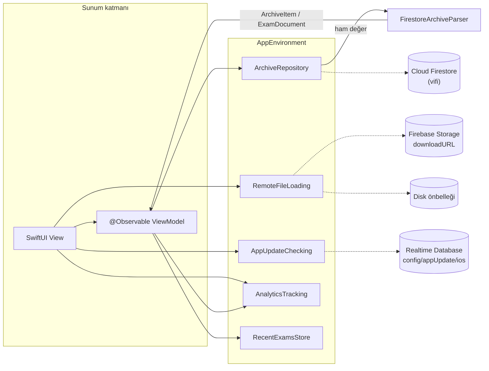
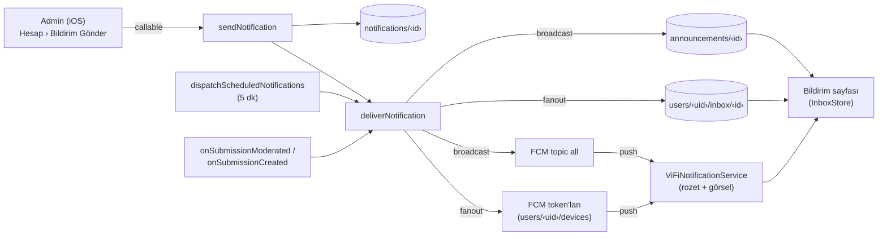

<div align="center">


# ViFi — Sınav Arşivi

Üniversitelerin geçmiş sınavlarına hızlıca ulaşmanı sağlayan iOS uygulaması.


</div>

---

## İçindekiler

- [Hakkında](#hakkında)
- [Özellikler](#özellikler)
- [Ekran Görüntüleri](#ekran-görüntüleri)
- [Mimari](#mimari)
- [Bildirimler](#bildirimler)
- [Klasör Yapısı](#klasör-yapısı)
- [Gereksinimler](#gereksinimler)
- [Kurulum](#kurulum)
- [Örnek Veriyle Çalıştırma](#örnek-veriyle-çalıştırma)
- [Testler ve Kod Kalitesi](#testler-ve-kod-kalitesi)
- [Firebase Güvenlik Kuralları](#firebase-güvenlik-kuralları)
- [Geliştirici Rehberi](#geliştirici-rehberi)
- [Sürüm Notları](#sürüm-notları)
- [Bilinen Durumlar](#bilinen-durumlar)

## Hakkında

**ViFi**, öğrencilerin üniversitelerine ait geçmiş dönem sınavlarını tek bir yerden bulup incelemesi için
geliştirilmiş bir sınav arşividir. Arşiv beş seviyeden oluşur:

```
Üniversite › Fakülte › Bölüm › Ders › Sınav
```

Her sınav ya sayfa sayfa görsellerden (JPG) ya da bir PDF belgesinden oluşur. Arşiv Cloud Firestore'da,
sınav dosyaları ise Firebase Storage'da tutulur. (Kullanıcı profili ve güncelleme politikası Realtime Database'de kalır.)

## Özellikler

| Özellik | Açıklama |
|---|---|
| **Hiyerarşik gezinme** | Üniversiteden sınava kadar tek bir gezinme yığını; üstteki içerik yolu (breadcrumb) ile herhangi bir üst seviyeye tek dokunuşla dön. |
| **Arama** | Her listede Türkçe karakter ve büyük/küçük harf duyarsız arama (`ı/i`, `ş/s`, `ğ/g`…). |
| **Son görüntülenenler** | Ana sayfada son açılan sınavlar; tek dokunuşla tekrar aç, listeden kaldır ya da tümünü temizle. |
| **Görsel sınav görüntüleyici** | Sayfa kartları, tam ekran sayfalayıcı, 1–5x yakınlaştırma, çift dokunarak yakınlaştır/sıfırla. |
| **Uygulama içi PDF** | PDFKit ile sürekli kaydırma, sayfa göstergesi ve birden fazla dosya arasında geçiş. |
| **Çevrimdışı önbellek** | Açılan sınav dosyaları cihazda saklanır; daha önce açılan sınavlar tekrar indirilmeden açılır. |
| **Karanlık mod** | Tüm ekranlar sistem renkleriyle açık ve koyu temaya uyum sağlar. |
| **Erişilebilirlik** | Dynamic Type, VoiceOver etiketleri ve iPad'de okunabilir satır genişlikleri. |
| **Telefonla giriş** | Uygulamanın tamamı telefon numarasıyla (SMS kodu, yalnızca +90) girişi gerektirir; kod son hane girilince otomatik gönderilir, tekrar gönderme 60 sn bekletilir. |
| **Profil** | Girişten sonra zorunlu "Profilini Tamamla" kapısı: ad, soyad, üniversite, fakülte, bölüm, cinsiyet. Üniversite/fakülte/bölüm uygulamaya gömülü listeden aranıp seçilir, listede yoksa serbest yazılır; telefon numarası doğrulanmış hâliyle salt-okunur gösterilir. Profil `users/<uid>/profile` altında saklanır ve Hesap'tan düzenlenebilir. |
| **Hesap** | Ana sayfadaki kişi simgesinden profilini düzenle, numaranı gör, çıkış yap ya da hesabını kalıcı olarak sil. |
| **Güncelleme kapısı** | Sürüm politikası uzaktan (Realtime Database) yönetilir: yeni bir sürüm için kapatılabilir öneri (bu sürümü atlama seçeneğiyle), minimum sürümün altındakiler için kapatılamayan zorunlu güncelleme ekranı. |
| **Bildirimler** | Zil simgesindeki tek bildirim sayfası: genel duyurular, sana özel bildirimler (sınavın onaylandı / reddedildi, bölümüne yeni sınav eklendi) ve kampanyalar. Okunmamışlar cihazlar arasında senkron; push'a dokunmak (uygulama açık, arka planda ya da kapalıyken) sayfayı açar ve o bildirimi vurgular. Kartlarda tek aksiyon: Sınava Git (arşivin kilit kuralıyla), Premium'a Göz At, Sınav Ekle, Bağlantıyı Aç, Konuma Git (Google / Apple Haritalar). Görselli push ve ikon rozeti. Ayrıntı: [Bildirimler](#bildirimler). |
| **Bildirim ayarları** | Hesap › Bildirim Ayarları: sistem izni durumu ve ayrı **Kampanya ve fırsat bildirimleri** anahtarı. Varsayılan kapalıdır; kapalıyken kampanya ne push ne sayfa olarak gelir. Gece 22:00–09:00 arası kampanya gönderilmez. |
| **Bildirim yönetimi (admin)** | Yönetici hesaplar Hesap › Bildirim Gönder ile duyuru ya da kampanya yollar: kitle (herkes ya da üniversite › fakülte › bölüm + cinsiyet), görsel, aksiyon (sınav / konum / Premium / Sınav Ekle / bağlantı), ileri tarih + geçerlilik süresi, kesin kitle sayısıyla onay, "bana test gönder"; geçmişte durum, sayılar (gönderilen / açılan / dokunulan) ve zamanlanmışı iptal. |
| **Gizlilik** | Reklam yok, reklam kimliği (IDFA) yok, takip izni istenmez. Kampanya bildirimleri yalnızca açık onayınla gönderilir. |

## Ekran Görüntüleri

<!--
Ekran görüntülerini örnek veriyle (-ViFiMockData) alıp docs/screenshots/ altına ekleyin ve aşağıdaki
tabloyu  biçimindeki etiketlerle güncelleyin.
Açık ve koyu tema için ayrı görüntüler önerilir.
-->

| Ana Sayfa | Gezinme | Görsel Sınav | PDF |
|:---:|:---:|:---:|:---:|
| _yakında_ | _yakında_ | _yakında_ | _yakında_ |

## Mimari

ViFi; **SwiftUI**, **MVVM** ve **Observation** çatısı üzerine kurulu, Swift 6 katı eşzamanlılık
(strict concurrency) modunda derlenen bir uygulamadır.



### Temel kararlar

- **SwiftUI + MVVM + Observation.** Ekran durumları `@Observable` view model'lerde tutulur ve view tarafından
  `@State` ile sahiplenilir. Combine ve `ObservableObject` kullanılmaz; asenkron işler `async/await` ile yürür.
- **Swift 6 ve MainActor varsayılanı.** Proje `SWIFT_DEFAULT_ACTOR_ISOLATION = MainActor` ile derlenir; görsel
  çözme, dosya ve JSON işlemleri gibi ağır işler `nonisolated` fonksiyonlarla ana iş parçacığının dışında yapılır.
- **Protokol arkasındaki servisler.** Veri katmanı `ArchiveRepository`, `RemoteFileLoading`, `AppUpdateChecking`,
  `AnalyticsTracking`, `AuthServicing` ve `RequestAuthorizing` (bildirim tarafında `InboxReading`, `DeviceRegistering`,
  `NotificationSettingsServicing`, `NotificationAdminServicing`, `NotificationEventReporting`, `LocationPicking`) protokolleri
  üzerinden kullanılır. Böylece Firebase, App Store ve ağ erişimi testlerde ve
  önizlemelerde örnek implementasyonlarla değiştirilebilir.

  | Protokol | Canlı implementasyon | Örnek (DEBUG) implementasyon |
  |---|---|---|
  | `ArchiveRepository` | `FirestoreArchiveRepository` (rollback: `FirebaseArchiveRepository` / RTDB) | `MockArchiveRepository` |
  | `RemoteFileLoading` | `RemoteFileLoader` | `RemoteFileLoader` (paket içi örnek dosyalar) |
  | `AppUpdateChecking` | `RemoteAppUpdateChecker` (kaynak: `FirebaseRemoteConfigReader`) | `StubUpdateChecker` |
  | `AppConfigReading` | `FirebaseRemoteConfigReader` | — (test double) |
  | `AnalyticsTracking` | `FirebaseAnalyticsTracker` | `NoOpAnalyticsTracker` |
  | `AuthServicing` | `FirebaseAuthService` | `MockAuthService` (kod: `111111`) |
  | `RequestAuthorizing` | `FirebaseRequestAuthorizer` | — (örnek dosyalar `file://`, yetki gerekmez) |
  | `NotificationServicing` | `SystemNotificationService` | `MockNotificationService` |
  | `InboxReading` | `FirebaseInboxReader` | `StubInboxReader` |
  | `DeviceRegistering` | `FirebaseDeviceRegistrar` | `MockDeviceRegistrar` |
  | `NotificationSettingsServicing` | `FirebaseNotificationSettingsService` | `StubNotificationSettingsService` |
  | `NotificationAdminServicing` | `FirebaseNotificationAdminService` | `MockNotificationAdminService` |
  | `NotificationEventReporting` | `FirebaseNotificationEventReporter` | `MockNotificationEventReporter` |
  | `LocationPicking` | `GoogleLocationPicker` (Google Maps + Places) | `MockLocationPicker` |

- **Giriş zorunlu.** Uygulamanın tamamı telefon numarasıyla (SMS kodu, yalnızca +90) giriş gerektirir. `SessionStore`
  oturum durumunu (`unknown` / `signedOut` / `signedIn`) tutar; `RootView` buna göre `LoginView` ya da arşivi
  gösterir. Hesap ekranı (`AccountView`) çıkış ve kalıcı hesap silme sunar. `AppDelegate`, APNs belirtecini ve
  sessiz bildirimleri Firebase Auth'a iletir (swizzling kapalı); reCAPTCHA dönüşü `onOpenURL` ile iletilir. FCM token'ı
  `DeviceRegistrationStore`'a, bir push'a dokunuş `NotificationRouter`'a verilir (bkz. [Bildirimler](#bildirimler)).
- **App Check.** `live()` Firebase'i yapılandırmadan önce App Check sağlayıcısını kurar: Release'te App Attest
  (desteklenmeyen cihazda DeviceCheck), Debug ve simülatörde debug sağlayıcısı.
- **Yetkili dosya indirme.** Storage dosyaları Firestore'da `storagePath` olarak saklanır; indirme URL'i
  `StorageURL.canonical` ile kurulur. İndirme `downloadURL` içindeki `token=` parametresiyle değil, kullanıcının
  ID belirteci (`Authorization: Firebase …`) ve App Check belirteci (`X-Firebase-AppCheck`) ile yapılır. Önbellek
  anahtarı `token` parametresi çıkarılmış kanonik URL'dir.

- **AppEnvironment ile bağımlılık enjeksiyonu.** Tüm servisler tek bir `AppEnvironment` nesnesinde toplanır ve
  `.environment(_:)` ile view hiyerarşisine verilir. `live()` üretim servislerini, `mock()` örnek veriyi kurar;
  `makeDefault()` başlatma argümanına göre ikisinden birini seçer. Ortam `AppDelegate` tarafından ilk erişimde (`didFinishLaunching` içinde) kurulur; Firebase Auth'un APNs yöneticileri `UIApplication` varken oluşsun diye bu sıra önemlidir.
- **Router.** Gezinme durumu `NavigationStack` yolunu tutan `@Observable Router` nesnesindedir. `Route` enum'u
  (`browse`, `exam`) tüm hedefleri tanımlar; breadcrumb'a dokunmak `popTo(_:)`, son görüntülenen bir sınavı açmak
  ise `openExam(at:kind:)` ile tüm üst seviyeleri yığına yerleştirir, böylece Geri tuşu arşivde yukarı yürür.
- **Arşiv ayrıştırıcıları.** Canlı yolda `FirestoreArchiveParser`, Firestore dokümanı sözlüklerini
  (`DocumentSnapshot.data()`) modellere çevirir; dosya URL'leri `storagePath`→`StorageURL`. Rollback RTDB yolunda
  `ArchiveParser` ham değerleri çevirir (isim yer tutucularını `uniname`/`fakname`… atlar, dizileri normalize eder).
  İkisi de Firebase'e bağımlı olmayan saf katmanlardır; listeler Türkçe harf sıralaması ile sayı farkındalıklı
  sıralanır (sınavlar en yeniden eskiye).
- **Çevrimdışı önbellek.** `RemoteFileLoader` dosyaları geniş bir `URLCache` ve `Caches/ExamFiles` altındaki disk
  önbelleği ile indirir; görseller ekran boyutuna göre küçültülerek çözülür. Firestore'un `keepSynced`'i
  olmadığından, arşiv listeleri için `ArchivePrefetcher` giriş sonrası (çevrimiçiyken, throttle'lı) tüm arşivi
  Firestore kalıcı önbelleğine ısıtır; böylece ziyaret edilmemiş dallar da çevrimdışı açılır.
- **Durum ve günlük.** Ekran içerikleri `Loadable` (`loading` / `loaded` / `failed`) ile modellenir; hatalar
  `ArchiveError` üzerinden kullanıcıya Türkçe mesajlarla gösterilir. Günlükler `print` yerine OSLog
  (`Logger.archive`, `Logger.files`, `Logger.app`) ile yazılır.

### Veritabanı yapısı

```
Cloud Firestore (isimli `vifi` veritabanı) — arşiv ve bildirimler:
  catalogNodes/<id>  { level: university|faculty|department|course, name, parentId, status: published, childCount, slug }
  exams/<id>         { title, courseId, kind: JPG|PDF, status: published, files: [{ storagePath, order }], <denormalize adlar> }

  notifications/<id>                { kind, title, body, image?, action?, audience, audienceLabel, delivery, status,
                                      scheduledAt?, expiresAt?, source, stats{…}, … }   # admin geçmişi; yalnız Function yazar
  announcements/<id>                { kind, title, body, image?, action?, createdAt, expiresAt? }   # genel duyuru kopyası
  users/<uid>/inbox/<id>            { kind, title, body, image?, action?, createdAt, expiresAt? }   # kişiye teslim kopyası
  users/<uid>/devices/<kurulumId>   { token, platform, appVersion, updatedAt }
  users/<uid>/settings/notifications { marketing, source: prompt|settings, version, updatedAt }     # kampanya onayı
  users/<uid>/settings/inbox        { readAt }                                                      # okunmamış = createdAt > readAt
  notificationThrottle/<üniv>__<fak>__<böl>  { lastSentAt, notificationId }   # yalnız sunucu ("yeni sınav" günlük sınırı)

Realtime Database — profil + güncelleme politikası (Firestore'a taşınmadı):
  users/<uid>/profile/{ name, surname,
                        university, universityId, universityIsCustom,
                        faculty,    facultyId,    facultyIsCustom,
                        department, departmentId, departmentIsCustom,
                        gender, phoneNumber, updatedAt }
  config/appUpdate/ios/{ minimumVersion, latestVersion, storeURL, message }
```

Bir seviye `catalogNodes` içinde `where(parentId == <üst id>, status == published)`, bir dersin sınavları `exams`
içinde `where(courseId == <ders id>, status == published)` ile listelenir; her ikisi de istemcide Türkçe sıralanır.
Kanonik id'ler slug'dır (profil `*Id`'leri ve FCM topic'leriyle aynı üretilir). Eski RTDB arşivi
(`Universitiess/<üniv>/…/<JPG|PDF>/<pushId>/downloadURL`, her düğüm adını `uniname`/`fakname`… yaprağında tutar)
rollback için duruyor. Ayrıntı: [FIRESTORE-MIGRATION.md](FIRESTORE-MIGRATION.md).

Kullanıcı profili `users/<uid>/profile` altında tutulur: `gender` yalnızca `female`/`male`, `phoneNumber` auth
token'ındaki doğrulanmış numarayla aynı olmak zorunda, `updatedAt` her yazımda sunucu zaman damgası. Sahibi (+90)
yalnızca kendi profilini okur/yazar; admin tüm profilleri okur. Giriş sonrası `ProfileStore` profili yükler ve
`RootView` profil tamamlanana kadar arşivi açmaz.

Üniversite/fakülte/bölüm hem **görünen ad** hem **kanonik id** (slug) olarak saklanır. Kanonik id'ler **bildirim
segmentleri** (üniversite › fakülte › bölüm + cinsiyet) için kullanılır: Cloud Function kitleyi `users` düğümünde
`profile/universityId` ile (indeksli) sorgular, fakülte/bölüm/cinsiyeti bellekte süzer. Listeden seçilince id kanonik
olur, serbest yazılınca `*IsCustom=true` ve `Slug` ile best-effort bir id üretilir. `users` düğümü
`profile/universityId`, `facultyId`, `departmentId`, `gender` üzerinde indekslidir.

## Bildirimler

Hedefli bildirim sistemi **sunucu tarafında** çalışır: admin uygulamadaki ekrandan bir Cloud Function'ı çağırır,
Function kaydı yazar ve alıcılara teslim eder. İstemci yalnızca okur, cihazını kaydeder ve izin/onay tercihini yazar.
Backend ve payload platform-bağımsızdır (Android istemci ayrı depoda yazılacak).

> [!IMPORTANT]
> **Bu sistemin hiçbir parçası henüz canlıda değil.** Kod ve emulator testleri hazır; canlı `vifi-831a8` projesinde yeni
> Firestore/Storage kuralları, Cloud Functions, IAM rolü, Cloud Scheduler işi ve Apple App Group yayınlanmadı. Yayın
> sırası ve önkoşulları için bkz. [Yayın önkoşulları](#yayın-önkoşulları). Yayındaki 4.0.0 istemcisi `all` topic'ine
> abone olur ve `announcements`'ı okur; genel duyurular ona da ulaşmaya devam eder.



### Kullanıcı tarafı

- **Bildirim sayfası** (ana sayfadaki zil, `InboxView`): `announcements` (son 50) ile `users/<uid>/inbox` (son 100) tek
  listede, yeniden eskiye. Süresi dolanlar düşer. **Okunmamış** = `createdAt > users/<uid>/settings/inbox.readAt`; sayfa
  açılınca tek bir `readAt` yazılır, böylece rozet cihazlar arasında senkron kalır. Bir kaynak okunamazsa liste boş gibi
  gösterilmez (hata + "Tekrar Dene").
- **Push'a dokunmak** (uygulama açık, arka planda ya da kapalı): `AppDelegate` yalnızca `NotificationRouter`'a bir istek
  bırakır; güncelleme / giriş / profil kapıları geçilince ve engelleyen bir modal kalmayınca bildirim sayfası açılır ve
  ilgili öğe vurgulanır (`notificationId` yoksa yalnız sayfa açılır).
- **Kart aksiyonları** (tek aksiyon; karta ya da düğmeye dokunmak aynı şeyi yapar): `exam` "Sınava Git" — **arşivin kilit
  kuralından geçer** (kilitliyse kilit sayfası; aboneler ve daha önce açanlar doğrudan girer); `location` "Konuma Git" —
  Google Haritalar uygulaması, yoksa web, ya da Apple Haritalar; `paywall` "Premium'a Göz At" (aboneye gösterilmez);
  `addExam` "Sınav Ekle"; `url` "Bağlantıyı Aç" (yalnız `https`). Görsel `image.storagePath` ile kimlikli indirilir.
- **İzin akışı** (`NotificationPromptCoordinator`): giriş sonrası ilk açılışta soru sormadan **provisional** izin
  (bildirimler sessizce Bildirim Merkezi'ne düşer) → tanıtım turundan sonra **1/2 "Hiçbir şeyi kaçırma"** (tam izin) →
  yalnız tam izin varsa **2/2 "Öğrenci fırsatları"** (kampanya onayı; hiçbiri önceden seçili değil). 1/2'de "Şimdi Değil"
  ya da sistem penceresinde ret → en erken 30 gün sonra, ilk sınav gönderiminden sonra **bir kez** tekrar; 2/2'de "Hayır"
  → en erken 30 gün sonra bildirim sayfası açılınca **bir kez** tekrar. Sonrası yalnız **Hesap › Bildirim Ayarları**'ndan
  (sistem izni durumu + "Kampanya ve fırsat bildirimleri" anahtarı). Onay `users/<uid>/settings/notifications`'a
  `{marketing, source, version, updatedAt}` olarak yazılır; izin karşılığında coin vb. ödül **yoktur**.
- **Rozet ve görsel:** uygulama arka plana geçerken ikon rozeti = okunmamış sayısı, açılınca 0. `ViFiNotificationService`
  (Notification Service Extension) her push'ta rozeti App Group (`group.com.BuyukerYazilim.ViFi2`) sayacına göre +1 yapar
  ve push görselini ekler; görsel inmezse bildirim görselsiz ama rozetli gösterilir.
- **Cihaz kaydı:** FCM token'ı + oturum birlikte olunca `users/<uid>/devices/<kurulum-UUID'si>` yazılır; çıkış ve hesap
  silmeden önce silinir (en çok 3 sn beklenir, başarısızlık çıkışı engellemez). Aynı token başka hesapta görülürse
  sunucu eski kaydı siler (`onDeviceWritten`).

### Admin tarafı (Hesap › Bildirim Gönder, `admin: true` claim'i gerekir)

Tür (Duyuru / Kampanya), başlık (≤80) ve mesaj (≤500), kitle (**Hepsi** ya da **segment**: üniversite zorunlu → fakülte →
bölüm + cinsiyet; seçiciler yalnızca kayıtlı kullanıcısı olan değerleri kişi sayılarıyla listeler), görsel (JPEG ≤ 1 MiB),
aksiyon (yok / Premium / Sınav Ekle / bağlantı / arşivden sınav / haritadan konum), ileri tarih ve geçerlilik süresi.
**Gönder** önce sunucudan kesin kitle sayısını alır ve onay ister; **Bana test gönder** yalnızca göndericiye gider ve
ertelenmez. **Konum** seçilince Tür görünür şekilde Kampanya'ya kilitlenir (sunucu da zorlar). Geçmiş ekranı durumu
(zamanlandı / gönderiliyor / gönderildi / başarısız / iptal), kitle etiketini, sayıları (alıcı, push, açılma, aksiyon) ve
zamanlanmış bildirim için iptali gösterir.

Konum seçici Google Maps SDK + Places arama kullanır; açılınca (yalnızca admin, yalnızca bu ekranda) "uygulamayı
kullanırken" konum iznini bir kez ister ve haritayı cihazın konumuna odaklar (düzenlenen konum ya da admin'in daha önce
taşıdığı/seçtiği yer öncelikli; konum kaydedilmez, gönderilmez). Haritada bir mekân etiketine dokunmak onu seçer (ad +
koordinat + place id, adres ardından gelir). Anahtar yoksa seçici
"yapılandırılmamış" der; örnek veri modunda Google SDK'sı hiç başlatılmaz (`MockLocationPicker`).

### Sunucu kuralları

| Konu | Davranış |
|---|---|
| Teslim biçimi | `broadcast`: (`general`\|`system`) + tüm kullanıcılar → `announcements/<id>` + FCM topic `all`. `fanout`: geri kalan her şey (segment, **tüm kampanyalar**, kişisel, admin, test) → alıcı başına `users/<uid>/inbox/<id>` + kayıtlı token'lar (500'lük paketler, ölü token'lar silinir). Tüm yollar tek `deliverNotification`'dan geçer. |
| Kampanya onayı (Apple 4.5.4) | `promo` yalnızca `settings/notifications.marketing == true` olanlara gider; sunucu `fanout` öncesi süzer. Onay ayrıdır, varsayılan kapalıdır, atlanamaz. Konumlu bildirim her zaman kampanyadır. |
| Sessiz saatler | 22:00–09:00 (Europe/Istanbul) arası kampanya ve otomatik "yeni sınav" 09:00'a ertelenir. Kişisel sistem bildirimleri, admin'e giden bildirimler ve test anında gider. |
| Zamanlama | Gelecekteki `scheduledAt` (ya da ertelenen) kayıt `scheduled` olur; `dispatchScheduledNotifications` 5 dakikada bir teslim eder, süresi dolanı iptal eder, 15 dk'dan uzun `sending`'de takılanı bir kez yeniden dener. `cancelNotification` yalnız `scheduled`'ı iptal eder. |
| Otomatik bildirimler | Sınav gönderimi **onaylanınca** sahibine "Sınavın onaylandı (+coin)" ve (yeni sınav yayınlandıysa) bölümüne "yeni sınav" (bölüm başına günde en fazla 1, yükleyen hariç); **reddedilince** sahibine sebepli bildirim; yeni gönderim gelince tüm admin'lere bildirim. `exams` yazımı değil, moderasyon sonucu tetikler. |
| İstatistik | İstemci `opened` / `actionTapped` olaylarını `trackNotificationEvent` ile bildirir; kullanıcı başı tek sayılır, yalnız teslim kopyası olan alıcı sayılır. |
| Push görseli | Firestore'a yalnız `image.storagePath` yazılır (`notificationImages/<id>.jpg`, bir kez yüklenir, değiştirilemez). Push için sunucu gönderim anında 7 günlük V4 imzalı URL üretir ve yalnızca FCM payload'ına koyar. |
| Hesap silme | `onAccountDeleted` silinen hesabın Firestore `users/<uid>` altını (kilitler, inbox, cihazlar, ayarlar), cüzdan + ledger'ı, aboneliği, onay bekleyen gönderimleri + `pending/<uid>/` dosyalarını ve RTDB profilini siler. Arşive eklenmiş sınavlar ve incelenmiş gönderim kayıtları kalır; `purchasedTransactions` kaydı kalır ama hesaptan koparılır. |

**Cloud Functions** (`firebase/functions/`, europe-west1; mantık `notifications/` altında, `index.js` yalnızca bağlar):

| Function | Tür |
|---|---|
| `getNotificationAudience`, `previewNotification`, `sendNotification`, `cancelNotification` | callable, yalnız admin |
| `trackNotificationEvent` | callable, +90 kullanıcı |
| `dispatchScheduledNotifications` | `onSchedule`, 5 dk, Europe/Istanbul |
| `onDeviceWritten`, `onSubmissionModerated`, `onSubmissionCreated` | Firestore tetikleyicisi (isimli `vifi` DB) |
| `onAccountDeleted` | v1 Auth silme tetikleyicisi |

Sözleşmenin (türler, aksiyon tipleri, limitler, alan adları) tek yetkili kaynağı `notifications/schema.js`'tir; iOS
modelleri (`AppNotification.swift`, `NotificationAdmin.swift`) ve `NotificationPayloadParser` onunla aynı tutulur.

### Yayın önkoşulları

Hepsi proje sahibinin onayı/eylemiyle yapılır. **Durum (30 Ekim 2026):** 1–4 tamam (kurallar, 13 Function, IAM, App Group,
Google Cloud anahtarı), gerçek cihaz testi geçti, gizlilik manifestleri ve App Store Connect gizlilik etiketi güncellendi; kalan sürüm
gönderimi:

1. **Yeni istemciden önce** (4.0.0 ile geriye uyumlu; gerçek cihaz/TestFlight testi buna bağlı) Firestore kuralları +
   indeksleri ve Storage kuralları
   (`firebase deploy --only firestore,storage`).
2. Cloud Functions (`firebase deploy --only functions`). Öncesinde: Functions servis hesabına kendi üzerinde *Service
   Account Token Creator* rolü ve IAM Service Account Credentials API (imzalı push görsel URL'i; yoksa push görselsiz
   gider), Cloud Scheduler işi, `listUsers` için Auth admin yetkisi, 1. nesil auth fonksiyonu için nodejs22 + servis hesabı
   izinleri. Firestore tetikleyicileri isimli `vifi` DB'yi (eur3) dinler ve projenin ilk Firestore tetikleyicileridir:
   Eventarc tetikleyici konumu doğrulanmalıdır.
3. Apple Developer: App Group `group.com.BuyukerYazilim.ViFi2` oluşturulup `com.BuyukerYazilim.ViFi2` ve
   `com.BuyukerYazilim.ViFi2.NotificationService` App ID'lerinde etkinleştirilir, provisioning profilleri yenilenir.
4. Google Cloud: *Maps SDK for iOS* ve *Places API (New)* açık, uygulama kimliğine kısıtlı API anahtarı, günlük kota ve
   bütçe uyarısı; sürüm derlemesi `Config/Secrets.xcconfig` ile alınır.
5. Gerçek cihazda provisional → tam izin, görselli push ve rozet testi; App Store gizlilik etiketi (Google Maps SDK için
   Crash Data + Performance Data, kampanya hedeflemesi için User ID / Device ID / Other Data Types'a "Developer's
   Advertising or Marketing" amacı, Product Interaction'a "App Functionality" amacı). Konum etikete girmez: cihaz konumu
   yalnızca admin harita seçicisini odaklar, saklanmaz ve gönderilmez (App Review notunda belirtilir).

## Klasör Yapısı

```
ViFi-iOS/
├── project.yml              # XcodeGen tanımı — Xcode projesinin tek kaynağı
├── .swiftlint.yml           # Lint kuralları
├── Config/                  # Base.xcconfig (commit'li), Secrets.example.xcconfig (şablon); Secrets.xcconfig git-dışı (Google Maps anahtarı)
├── firebase/                # Güvenlik kuralları, kural testleri, Cloud Functions (functions/, bildirimler: functions/notifications/), belirteç iptal betiği (bkz. firebase/README.md)
├── ViFiNotificationService/ # Notification Service Extension: push'ta ikon rozeti +1 ve kampanya görseli
├── ViFi/
│   ├── App/                 # Uygulama girişi, AppDelegate, RootView, Router, AppEnvironment, NotificationRouter, NotificationPromptCoordinator
│   ├── Core/
│   │   ├── Models/          # ArchivePath, ArchiveItem, ExamDocument, PhoneNumber, UserProfile (+ Gender), AppNotification, NotificationAdmin, NotificationConsent
│   │   ├── Services/        # Servis protokolleri, ArchiveParser, UserProfileParser, Firebase / App Store servisleri, AuthServicing, SessionStore, ProfileServicing, ProfileStore, UniversityCatalog, App Check, RecentExamsStore; bildirim: NotificationPayloadParser, InboxStore, DeviceRegistrationStore, NotificationSettingsStore, NotificationPromptHistory, NotificationEventTracker, NotificationAdminServicing, GoogleMapsConfiguration
│   │   └── Utilities/       # Loadable, Logger, FirstOutcome, NotificationBadgeCounter (App Group rozet sayacı; uygulama + extension)
│   ├── DesignSystem/        # IconBadge, durum görünümleri, seviye stilleri
│   ├── Features/
│   │   ├── Auth/            # Telefon numarasıyla giriş (SMS kodu)
│   │   ├── Profile/         # Zorunlu profil tamamlama kapısı + profil düzenleme (ad/soyad/üniversite/fakülte/bölüm/cinsiyet)
│   │   ├── Account/         # Hesap: profil düzenle, Bildirim Ayarları, çıkış ve hesap silme
│   │   ├── Notifications/   # Bildirim sayfası (inbox), aksiyonlar, "Konuma Git", izin / kampanya onayı akışı
│   │   ├── NotificationComposer/ # Admin "Bildirim Gönder", geçmiş ve istatistik; LocationPicker/ (Google Maps + Places)
│   │   ├── Home/            # Ana sayfa, son görüntülenenler, Hakkında
│   │   ├── Browse/          # Fakülte → sınav listeleri, breadcrumb
│   │   └── Exam/            # Görsel ve PDF sınav görüntüleyicileri
│   ├── Resources/           # Assets, Info.plist, GoogleService-Info.plist, turkish-universities/-faculties/-departments.json
│   └── Preview Content/     # Önizleme ve örnek veri dosyaları (yalnızca geliştirme)
├── ViFiTests/               # Birim testleri
└── ViFiUITests/             # Arayüz testleri (örnek veriyle çalışır; Inbox, NotificationComposer, NotificationPermission, LocationCampaign dahil)
```

> **Not:** 2.x sürümünün UIKit/Storyboard kaynakları, `Podfile` ve `ViFi.xcworkspace` 3.0 ile kaldırıldı; git
> geçmişinde duruyorlar. Projeyi her zaman `ViFi.xcodeproj` ile açın, `pod install` çalıştırmayın.

## Gereksinimler

| Araç | Sürüm |
|---|---|
| Xcode | 26 veya üzeri |
| iOS / iPadOS | 17.0 veya üzeri |
| [XcodeGen](https://github.com/yonaskolb/XcodeGen) | 2.42 veya üzeri |
| [SwiftLint](https://github.com/realm/SwiftLint) | Önerilir (derleme sırasında çalışır) |

Bağımlılıklar Swift Package Manager ile yönetilir: Firebase iOS SDK 12 (`FirebaseFirestore`, `FirebaseDatabase`,
`FirebaseAnalyticsCore`, `FirebaseAuth`, `FirebaseAppCheck`, `FirebaseStorage`, `FirebaseFunctions`, `FirebaseMessaging`) ve
Google Maps iOS SDK + Places iOS SDK 11.2.0 (yalnızca admin konum seçicisi). CocoaPods kullanılmaz. Paket sürümleri
depodaki `Package.resolved` ile sabitlenir (Firebase 12.19.2, Google Maps / Places 11.2.0); güncellemek için Xcode'da
*File › Packages › Update to Latest Package Versions*. Cloud Functions için ayrıca Node.js 22 gerekir (`firebase/functions`).

## Kurulum

```bash
# 1. Araçları kur
brew install xcodegen swiftlint

# 2. Depoyu klonla
git clone https://github.com/emrebuyuker/ViFiIos.git ViFi-iOS
cd ViFi-iOS

# 3. Google Maps anahtarı için yerel gizli dosyayı oluştur (yalnızca admin konum seçicisi içindir; atlanırsa proje yine derlenir)
cp Config/Secrets.example.xcconfig Config/Secrets.xcconfig   # sonra GOOGLE_MAPS_API_KEY değerini doldurun

# 4. Xcode projesini üret
xcodegen generate

# 5. Projeyi aç (paketler ilk açılışta çözülür)
open ViFi.xcodeproj
```

- **Proje dosyası üretilir.** `ViFi.xcodeproj` XcodeGen tarafından `project.yml`'dan oluşturulur ve depoda tutulmaz
  (yalnızca SwiftPM kilit dosyası `Package.resolved` saklanır). Hedef, ayar ya da bağımlılık değişikliklerini
  `project.yml` üzerinde yapıp `xcodegen generate` komutunu tekrar çalıştırın.
- **Google Maps anahtarı (`Config/Secrets.xcconfig`).** Admin'in kampanya konumu seçtiği harita Google Maps SDK + Places
  API (New) kullanır. Anahtar `Config/Secrets.xcconfig` içindeki `GOOGLE_MAPS_API_KEY` ile verilir; dosya `.gitignore`'dadır
  ve **asla commit'lenmez** (depo herkese açıktır; şablon `Config/Secrets.example.xcconfig`). `Config/Base.xcconfig` onu
  isteğe bağlı (`#include?`) dahil eder ve `project.yml` değeri Info.plist'te `GMSApiKey` olarak yayınlar. Anahtar yoksa
  uygulama sorunsuz derlenir ve çalışır, yalnızca konum seçici "harita anahtarı yapılandırılmamış" der; SDK'lar uygulama
  açılışında değil, seçici ilk açılırken başlatılır, örnek veri modunda hiç başlatılmaz. Anahtarı Google Cloud'da (*Maps SDK
  for iOS* + *Places API (New)* açık) `com.BuyukerYazilim.ViFi2` paket kimliğine kısıtlayın, günlük kota ve bütçe uyarısı koyun.
- **GoogleService-Info.plist.** Canlı Firebase yapılandırması `ViFi/Resources/GoogleService-Info.plist` dosyasındadır.
  Kendi Firebase projenizle çalışacaksanız bu dosyayı kendi projenizin dosyasıyla değiştirin. Örnek veri modu
  Firebase'e hiç bağlanmaz ve bu dosyaya ihtiyaç duymaz.
- **Firebase Konsolu (proje sahibi yapar).**
  - *Authentication › Sign-in method*: **Phone** sağlayıcısını etkinleştirin. *Settings › SMS region policy*
    altında yalnızca Türkiye (TR) için izin listesi tanımlayın.
  - *Authentication › Phone*: geliştirme ve App Review için sahte test numaraları ekleyin (biçim `+90 5XX XXX XX XX`,
    kod `111111`). Debug'da `-ViFiPhoneAuthTesting` ile bu numaralarda uygulama doğrulaması atlanır. Depo herkese
    açık olduğundan gerçek test numaralarını hiçbir dosyaya yazmayın; bu numaralarla herkes SMS'siz giriş yapabilir.
  - *Project settings › Cloud Messaging*: Apple'dan APNs Auth Key (`.p8`) oluşturup Key ID ve Team ID ile yükleyin.
    Sessiz bildirimle doğrulama buna dayanır; yoksa giriş her zaman reCAPTCHA'ya düşer.
  - *App Check › Apps*: iOS uygulamasını **App Attest** sağlayıcısıyla kaydedin (yedek olarak DeviceCheck).
    Debug derlemesini ya da simülatörü bir kez çalıştırıp Xcode konsolundaki *Firebase App Check debug token*
    değerini *Manage debug tokens* altına ekleyin (CI için `FIRAAppCheckDebugToken`).
  - *App Check › APIs*: Realtime Database ve Storage için zorunlu kılmayı yalnızca yeni sürüm yayınlandıktan ve
    debug belirteçleri eklendikten sonra açın. **Firestore** için zorunlu kılmayı da Firestore-okuyan sürüm
    yayınlanıp App Check panelinde trafiğin "verified" olduğu görüldükten sonra açın (bkz. `FIRESTORE-MIGRATION.md`).
- **Bildirim backend'i (proje sahibi yapar).** Hedefli bildirimlerin Firestore/Storage kuralları, Cloud Functions'ı ve IAM
  / Cloud Scheduler önkoşulları **30 Ekim 2026'da yayınlandı**; sırası ve adımları için bkz. [Yayın önkoşulları](#yayın-önkoşulları).
  Yerelde `cd firebase && npm test` hepsini emulator'de doğrular (Functions emulator'ü başlatılmaz; handler'lar doğrudan çağrılır).
- **Apple Developer.** `com.BuyukerYazilim.ViFi2` kimliğinde **Push Notifications**, **App Attest** ve **App Groups**
  yeteneklerini etkinleştirip provisioning profillerini yenileyin (`ViFi.entitlements` bunları gerektirir). Bildirim
  extension'ı için `com.BuyukerYazilim.ViFi2.NotificationService` App ID'si de aynı App Group'a
  (`group.com.BuyukerYazilim.ViFi2`) bağlanır; ikon rozeti bu paylaşılan depoyla çalışır. Simülatör derlemeleri imza
  gerektirmez; cihaz derlemesinde extension otomatik imzalanır (Xcode App ID'sini ve App Group'u ekip altında kaydeder).
  App Store Connect gizlilik etiketlerine *Telefon Numarası* ve *Kullanıcı Kimliği* ekleyin.
- **İmzalama.** Simülatör derlemeleri imza gerektirmez. Gerçek cihazda çalıştırmak için `project.yml` içindeki
  `DEVELOPMENT_TEAM` ve provisioning profili ayarlarını kendi hesabınıza göre güncelleyin.

## Örnek Veriyle Çalıştırma

Uygulama, Firebase'e ve ağa hiç dokunmadan paket içindeki örnek arşivle çalışabilir. Bu mod UI testleri, demolar ve
Firebase erişimi olmayan geliştirme ortamları içindir ve yalnızca **Debug** derlemelerinde bulunur.

**Xcode'da:** *Product › Scheme › Edit Scheme… › Run › Arguments* altında *Arguments Passed On Launch* listesine
`-ViFiMockData` ekleyin.

**Komut satırında:**

```bash
# Derle (çıktı ./build altına)
xcodebuild -project ViFi.xcodeproj -scheme ViFi \
  -destination 'platform=iOS Simulator,name=iPhone 17 Pro' -derivedDataPath build build

# Simülatörü aç (zaten açıksa hata verir; yok sayılabilir), uygulamayı kur ve örnek veriyle başlat
xcrun simctl boot 'iPhone 17 Pro'
xcrun simctl install booted build/Build/Products/Debug-iphonesimulator/ViFi.app
xcrun simctl launch booted com.BuyukerYazilim.ViFi2 -ViFiMockData
```

Örnek arşiv; görsel ve PDF sınavlar, uzun isimli bir üniversite, sınavı olmayan bir ders ve dosyası olmayan bir
sınav gibi uç durumları içerir. SwiftUI önizlemeleri de aynı veriyi `AppEnvironment.mock()` üzerinden kullanır.

Örnek veri modunda kullanıcı oturum açmış olarak başlar. Diğer Debug başlatma argümanları:

| Argüman | Etki |
|---|---|
| `-ViFiSignedOut` | `-ViFiMockData` ile birlikte: oturum kapalı başlar (giriş ekranı). Her numara kabul edilir, kod `111111`. |
| `-ViFiPhoneAuthTesting` | Canlı Firebase ile: telefon doğrulamasında uygulama doğrulamasını (APNs / reCAPTCHA) kapatır. Yalnızca Firebase konsolunda tanımlı test numaralarıyla çalışır. |
| `-ViFiProfileIncomplete` | `-ViFiMockData` ile birlikte: profilsiz başlar, zorunlu "Profilini Tamamla" kapısından açılır. |
| `-ViFiForceUpdate` | `-ViFiMockData` ile birlikte: kapatılamayan zorunlu güncelleme ekranından başlar. |
| `-ViFiAdmin` | `-ViFiMockData` ile birlikte: kullanıcı admin sayılır; Hesap'ta Moderasyon ve **Bildirim Gönder** görünür. |
| `-ViFiNoCoins` | `-ViFiMockData` ile birlikte: coin bakiyesi 0 başlar (kilitli sınav / coin kazan istemi). |
| `-ViFiSubscribed` | `-ViFiMockData` ile birlikte: aktif Premium abonelikle başlar (arşiv açık, coin gizli). |
| `-ViFiShowOnboarding` | `-ViFiMockData` ile birlikte: ilk açılış tanıtım turunu zorla gösterir. |
| `-ViFiNotificationsPrompt` | `-ViFiMockData` ile birlikte: bildirim izni "sorulmamış", geçmiş boş (taze kurulum); izin akışı açılır: 1/2 "Bildirimleri Aç" → 2/2 kampanya onayı. |
| `-ViFiNotificationsDenied` | `-ViFiMockData` ile birlikte: sistem bildirim izni reddedilmiş (Hesap › Bildirim Ayarları "Ayarlar'ı aç" durumu). |
| `-ViFiNotificationsReask` | `-ViFiMockData` ile birlikte: izin adımı 31 gün önce reddedilmiş, izin "provisional"; sonraki sınav gönderiminden sonra tek seferlik tekrar sorulur. |
| `-ViFiConsentReask` | `-ViFiMockData` ile birlikte: kampanya onayı 31 gün önce reddedilmiş, kampanyalar kapalı; bildirim sayfası açılınca onay bir kez daha sorulur. |
| `-ViFiOpenNotification <id>` | `-ViFiMockData` ile birlikte: `<id>` bir sonraki argümandır; o push'a dokunulmuş gibi başlar, kapılardan sonra bildirim sayfası açılır ve `<id>` vurgulanır. |

## Testler ve Kod Kalitesi

```bash
# Birim ve arayüz testleri (kod kapsamı açık)
xcodebuild test -project ViFi.xcodeproj -scheme ViFi \
  -destination 'platform=iOS Simulator,name=iPhone 17 Pro'

# Lint ve otomatik düzeltme
swiftlint lint
swiftlint --fix
```

- **ViFiTests** — `ArchiveParser`, view model'ler, sürüm karşılaştırması ve son görüntülenenler gibi iş mantığını
  ağdan bağımsız olarak doğrular.
- **ViFiUITests** — Uygulamayı `-ViFiMockData` ile başlatır ve ana akışları (gezinme, arama, sınav açma, son
  görüntülenenler; bildirim sayfası, izin akışı, admin composer, konum kampanyası) uçtan uca test eder. Testler
  erişilebilirlik kimliklerine (`home.list`, `row.<ad>`, `breadcrumb.<i>`, `exam.images`, `inbox.row.<id>`,
  `notificationComposer.<öğe>`, `notificationSettings.<öğe>`, `locationPicker.<öğe>`…) dayanır; bu kimlikler testlerle
  yapılan bir sözleşmedir, değiştirilmemelidir.
- **firebase/tests** — Kural testlerinin yanında bildirim Function'larının handler'ları emulator'e karşı (sahte FCM ve
  imzalayıcıyla) ve `schema.js` saf birim testleriyle doğrulanır: `notificationSchema`, `notificationFunctions`,
  `notificationSchedule`, `notificationAutomatic`, `notificationStats`, `accountCleanup`.
- **SwiftLint** her derlemede çalışır. `print` yerine `Logger`, Combine yerine Observation kullanımı gibi proje
  kuralları da lint ile denetlenir.

## Firebase Güvenlik Kuralları

Kurallar ve testleri `firebase/` klasöründedir (operasyon özeti: [firebase/README.md](firebase/README.md)).
Varsayılan her şey kapalıdır; aşağıdaki izinler dışında kimse hiçbir şeye erişemez.

| Yol | Kim ne yapabilir |
|---|---|
| Firestore `catalogNodes`, `exams` | +90 telefonla girişli kullanıcılar ve yöneticiler okur; yalnızca yönetici yazar. |
| Firestore `submissions`, `wallets`, `subscriptions`, `users/<uid>/unlocks` | Coin/gönderim iskeleti: sahibi/yönetici okur; cüzdan + kilit yazımı yalnız sunucuda (istemci yazamaz). Ayrıntı: `firebase/firestore.rules`. |
| Firestore `announcements` | +90 telefonla girişli kullanıcılar ve yöneticiler okur; kimse yazamaz (yalnız Cloud Functions, Admin SDK). *(Yeni bildirim kuralları 30 Ekim 2026'da yayınlandı.)* |
| Firestore `notifications` | Yalnızca yönetici okur (geçmiş ekranı); kimse yazamaz. `events` alt koleksiyonu ve `notificationThrottle` istemciye tamamen kapalıdır. |
| Firestore `users/<uid>/inbox/<id>` | Sahibi okur; teslim kopyasını yalnız sunucu yazar. |
| Firestore `users/<uid>/devices/<kurulumId>` | Sahibi (+90) okur, oluşturur / günceller ve siler; yalnızca `{token, platform, appVersion, updatedAt}` (`updatedAt` sunucu zamanı), kimlik `^[A-Za-z0-9_-]{1,128}$`. |
| Firestore `users/<uid>/settings/notifications` | Sahibi okur ve yazar: yalnızca `{marketing, source: prompt\|settings, version, updatedAt}`; silinemez. |
| Firestore `users/<uid>/settings/inbox` | Sahibi okur; yalnızca `{readAt}` (sunucu zamanı) yazar; silinemez. |
| Realtime DB `/Universitiess` (rollback) | +90 telefonla girişli kullanıcılar ve yöneticiler okur; yalnızca yönetici yazar. Arşiv Firestore'a taşındı; bu kopya rollback için duruyor. |
| Realtime DB `/pendingExams/<uid>` | Kullanıcı yalnızca kendi kaydını okur; yeni gönderim oluşturur, kendi `pending` gönderimini siler, var olanı değiştiremez. Yönetici hepsini okur ve yazar. Alanlar sıkı doğrulanır. |
| Realtime DB `/users/<uid>/profile` | Sahibi (+90) yalnızca kendi profilini okur ve yazar; yönetici tüm profilleri okur (yazamaz). Alanlar sıkı doğrulanır: `gender` yalnızca `female`/`male`, `phoneNumber` token'daki numarayla aynı, `updatedAt` sunucu zaman damgası. |
| Realtime DB diğer tüm düğümler | Kimseye açık değil (yönetici dahil). |
| Storage `imagess/`, `pdfs/` | Tek dosya okuma: +90 kullanıcı ve yönetici. Listeleme kimseye açık değil; yalnızca yönetici yazar. |
| Storage `pending/<uid>/<gönderim>/` | Yalnızca sahibi yeni JPEG/PDF (1 bayt – 15 MiB) yükler, üzerine yazamaz; sahibi ve yönetici okur ve siler. |
| Storage `notificationImages/<bildirimId>.jpg` | Tek dosya okuma: +90 kullanıcı ve yönetici. Yalnızca yönetici **oluşturur** (JPEG, 1 bayt – 1 MiB); güncelleme, silme ve üzerine yazma yönetici dahil hiçbir istemciye açık değil. *(30 Ekim 2026'da yayınlandı.)* |

Yönetici, `admin: true` özel talebi (custom claim) taşıyan hesaptır: `setCustomUserClaims(uid, { admin: true })`.
Uygulama içi yönetici araçları (Moderasyon, Bildirim Gönder) Hesap ekranında yalnızca bu hesaplara görünür.

**Emülatör testleri** (Firebase CLI ve Java 21 gerekir; proje kimliği `demo-vifi`, gerçek projeye dokunulmaz):

```bash
cd firebase
npm install
JAVA_HOME=/opt/homebrew/opt/openjdk@21 npm test
```

**Yayınlama** (yalnızca giriş ve App Check içeren sürüm hazır olduğunda; eski sürümler anında bozulur):

```bash
cd firebase
firebase deploy --only database,storage,firestore --project vifi-831a8 --account <sahip hesabı>
```

**Cloud Functions** (bildirim sistemi dahil) ayrı yayınlanır ve ortak backend'i değiştirir; yalnızca proje sahibinin açık
onayıyla, [Bildirimler › Yayın önkoşulları](#yayın-önkoşulları) tamamlandıktan sonra:

```bash
cd firebase
firebase deploy --only functions --project vifi-831a8 --account <sahip hesabı>
```

Yayından önce konsoldan gereksiz kök düğümleri (`poc`, `2DfjkeJxHJTkdhz5VNVwFJzAeuD`, `Announcements`) silin.

**İndirme belirteçlerini iptal etme.** Mevcut `downloadURL` bağlantılarındaki `token=` parametresi kuralları
atlar. Yeni sürüm yayınlandıktan sonra `firebase/scripts/revoke-download-tokens.mjs` ile iptal edin
(`gcloud auth application-default login` ile proje sahibi olarak):

```bash
cd firebase
node scripts/revoke-download-tokens.mjs backup  --out backups/tokens-<tarih>.json
node scripts/revoke-download-tokens.mjs revoke  --backup backups/tokens-<tarih>.json           # deneme, değişiklik yapmaz
node scripts/revoke-download-tokens.mjs revoke  --backup backups/tokens-<tarih>.json --apply
node scripts/revoke-download-tokens.mjs restore --from   backups/tokens-<tarih>.json --apply   # geri al
```

> [!NOTE]
> Uygulamanın kendi indirmeleri (`alt=media`, kimlik + App Check belirteciyle) yeni belirteç **üretmez**; bu,
> 10.10.2026'daki iptal öncesinde canlı bucket'ta tek dosyayla ölçüldü. Ancak okuma yetkisi olan bir kullanıcı
> `getMetadata`/`getDownloadURL` çağırarak belirteçsiz bir dosyaya yeni belirteç ürettirebilir ve kalıcı bir genel
> bağlantı elde edebilir; bu kurallarla engellenemez. Bu yüzden iptal, sızmış bağlantıları temizleyen tek seferlik
> bir işlemdir ve her çalıştırmadan önce yeni yedek gerekir. Yükleyen kullanıcılar da kendi `pending/` dosyaları
> için belirteç alabilir. Bunlar yalnızca kurallarla kapatılamaz; ileride Cloud Functions (belirteç temizliği, kota)
> gerekebilir. Onay aracı, incelenen dosyanın `generation`/`md5Hash` değerini sabitleyip yalnızca baytları kopyalamalıdır.

## Geliştirici Rehberi

Bu bölüm ViFi'ye yeni kod eklerken izlenecek adımları toplar. Claude ile çalışırken kökteki
[`CLAUDE.md`](CLAUDE.md) aynı kuralları özetler ve ek çalışma talimatları içerir. Her yeni dosyadan önce projede
aynı isimli bir dosya olmadığını kontrol edin.

### Yeni ekran eklemek

1. Dosyaları `ViFi/Features/<Özellik>/` altına koyun: `<Ad>View.swift` ve `<Ad>ViewModel.swift`.
2. **View model:** `@Observable final class <Ad>ViewModel`. Ekran durumu `Loadable<Value>` ile tutulur;
   bağımlılıklar protokol tipinde ve `@ObservationIgnored private let` olarak saklanır.
3. **View iki parçadır:** Dışarıdaki `struct <Ad>View`, bağımlılıkları `@Environment(AppEnvironment.self)` ile alır.
   İçerideki `private struct <Ad>Screen`, view model'i `@State` ile sahiplenir (`HomeView` / `HomeScreen` gibi).
   Yükleme, hata ve boş durumlar için `LoadingStateView`, `ErrorStateView` ve `EmptyStateView` kullanılır.
4. **Gezinme:** Yığına eklenen bir ekransa `Route`'a yeni bir case ekleyip `RootView.destination(for:)` içinde
   karşılayın. Modal ekranlar `.sheet` ile açılır (`AboutView`, `AccountView` gibi).
5. **Erişilebilirlik ve analitik:** Etkileşimli her öğeye `accessibilityIdentifier("<ekran>.<öğe>")` verin. Ekran
   görüntülemesini `environment.analytics.track(.screenView(name:))` ile bildirin.
6. **Önizleme ve test:** `#if DEBUG` içinde `AppEnvironment.mock()` kullanan bir `#Preview` ekleyin. View model için
   `ViFiTests/<Ad>ViewModelTests.swift` birim testini, kullanıcı akışı varsa UI testini yazın.

### Yeni servis eklemek

1. **Protokol:** `ViFi/Core/Services/ServiceProtocols.swift` içine (ya da `AuthServicing.swift` gibi kendi dosyasına)
   `AnyObject` protokolü olarak, `async` API ile tanımlayın. Kullanıcıya gösterilecek hatalar `ArchiveError`,
   `AuthError` ya da Türkçe `errorDescription` sağlayan yeni bir `LocalizedError` olmalıdır.
2. **Canlı implementasyon:** `ViFi/Core/Services/` altına ekleyin. Firebase kullanıyorsa yalnızca
   `AppEnvironment.live()` içinde oluşturun. Örnek veri modu Firebase'i hiç yapılandırmaz.
3. **Örnek ve test sürümleri:** Debug örneği `ViFi/Preview Content/MockServices.swift` (`#if DEBUG`), test double'ı
   `ViFiTests/TestDoubles.swift` içine eklenir.
4. **Bağlama:** `AppEnvironment`'a özellik ve `init` parametresi ekleyip `live()` ile `mock()`'u güncelleyin.
5. **Eşzamanlılık:** Ağır işler (JSON, görsel çözme, disk) `@concurrent nonisolated static` fonksiyonlarda yapılır.
   Ana iş parçacığına taşınan modeller `nonisolated` ve `Sendable` olur. Günlükler `Logger.archive`, `Logger.files`
   ya da `Logger.app` ile yazılır.

### Test yazmak

- **Birim testleri:** Swift Testing kullanılır (`import Testing`, `@Test`, `#expect`, `#require`); testler ağa
  çıkmaz. Hazır yardımcılar `TestDoubles.swift` içindedir: `StubArchiveRepository`, `StubAuthService`,
  `StubRequestAuthorizer`, `StubURLProtocol`, `AsyncGate`, `TestClock`, `TemporaryDefaults` ve `Fixture`.
- **Arayüz testleri:** Uygulamayı `-ViFiMockData` ile (giriş akışı için ek olarak `-ViFiSignedOut`) başlatır ve
  erişilebilirlik kimlikleriyle ilerler. Örnek modda doğrulama kodu `111111`'dir.
- **Bildirim test yardımcıları:** `NotificationTestDoubles.swift` (`StubNotificationAdminService`, `SpyDeviceRegistrar`),
  `InboxTestDoubles.swift`, `NotificationPromptTestDoubles.swift`; saat ve `UserDefaults` enjekte edilir (`TemporaryDefaults`,
  `NotificationPromptHistory(now:)`), böylece 30 günlük tekrar-sorma süresi beklemeden test edilir.
- **Kural ve Function testleri:** Her kural değişikliği için `firebase/tests/` altına hem izin verilen hem reddedilen durumu
  kapsayan test eklenir ve `cd firebase && npm test` ile çalıştırılır. Cloud Function handler'ları bağımlılık
  enjeksiyonludur (`db`, `rtdb`, `messaging`, `bucket`, `signImageUrl`, `auth`, `now`): testler onları emulator Firestore/RTDB
  ve sahte FCM ile doğrudan çağırır, Functions emulator'ü gerekmez.

### Proje ayarı veya bağımlılık değiştirmek

Hedef, derleme ayarı, paket ve Info.plist değişiklikleri yalnızca `project.yml` üzerinden yapılır. Ardından
`xcodegen generate` çalıştırılır ve proje derlenir. `ViFi/Resources/Info.plist` üretilen bir dosyadır, elle
düzenlenmez. Entitlement değerleri `ViFi/Resources/ViFi.entitlements` dosyasında düzenlenir (yolu `project.yml`'de
`CODE_SIGN_ENTITLEMENTS` ile tanımlıdır). Paket sürümü değişirse `Package.resolved` commit'lenir.

Bildirim extension'ı (`ViFiNotificationService`) `project.yml`'de ayrı bir `app-extension` hedefidir ve uygulamaya gömülür;
Info.plist'i `info:` bloğundan üretilir, entitlement'ı `ViFiNotificationService/ViFiNotificationService.entitlements`'tadır.
Uygulama ile extension aynı App Group'u taşır; birini değiştirirsen ikisini de değiştir. Extension'a uygulama kodu
yalnızca `project.yml`'de açıkça listelenen, yalnızca Foundation kullanan dosyayla (`NotificationBadgeCounter.swift`)
paylaşılır; extension kodu `nonisolated`'dır. Gizli değerler `Config/Secrets.xcconfig`'e (git-dışı) ve şablonuna
(`Secrets.example.xcconfig`) eklenir; `Config/Base.xcconfig` paylaşılan ayarları ve `#include?` satırını tutar.

### Firebase kuralı değiştirmek

1. `firebase/database.rules.json`, `firebase/firestore.rules` (+ gerekiyorsa `firestore.indexes.json`) veya
   `firebase/storage.rules` dosyasını düzenleyin.
2. Değişikliği kapsayan olumlu ve olumsuz testleri `firebase/tests/` altına ekleyin.
3. `cd firebase && npm test` ile emulator'de doğrulayın.
4. Proje sahibinin onayıyla yayınlayın (komut: [Firebase Güvenlik Kuralları](#firebase-güvenlik-kuralları)).
5. Uygulamayı simülatörde canlı veriyle deneyin: giriş, liste ve sınav açma.

### Bildirim eklemek veya değiştirmek

Sözleşme üç yerde aynı olmalıdır: `firebase/functions/notifications/schema.js` (yetkili), iOS modelleri
(`AppNotification.swift`, `NotificationAdmin.swift`) ve `NotificationPayloadParser.swift`.

1. **Yeni tür, aksiyon tipi, limit ya da alan:** önce `schema.js` (+ `notificationSchema.test.mjs`), sonra iOS modelleri ve
   ayrıştırıcı (+ `NotificationPayloadParserTests`), sonra arayüz (`InboxView` aksiyon düğmesi, composer seçicisi) ve
   gerekiyorsa `firestore.rules` şekil kuralı + testi. Yeni arayüz öğesine `inbox.…` / `notificationComposer.…` kimliği verin.
2. **Yeni gönderim yolu ya da otomatik bildirim:** kaydı `notifications/<id>`'ye yazıp **`deliverNotification`**'a verin
   (yalnızca `status: 'sending'` kaydı teslim eder; yeni bir teslim kodu yazmayın). Otomatik bildirimde deterministik bir
   id kullanıp kaydı `create()` ile yazın (olay iki kez gelirse iki kez gitmesin); handler'ı `notifications/` altına,
   bağımlılık enjeksiyonlu yazıp `index.js`'te bağlayın.
3. **Kampanya ya da sessiz saat davranışı:** kararlar yalnızca sunucuda (`deliveryMode`, `respectsQuietHours`,
   `filterMarketingConsent`) verilir; istemci yalnızca onay tercihini yazar. İstemciye "promo'yu atla" yolu eklemeyin.
4. **Yeni mock/UI test senaryosu:** `LaunchArgument` + `AppEnvironment.mock(arguments:)` tohumlaması; tabloyu
   [Örnek Veriyle Çalıştırma](#örnek-veriyle-çalıştırma) ve `CLAUDE.md`'de güncelleyin.
5. **Yayın:** kural ve Function değişiklikleri canlıya yalnızca proje sahibinin onayıyla çıkar
   ([Yayın önkoşulları](#yayın-önkoşulları)).

### Sürüm öncesi kontrol listesi

- [ ] `project.yml` içinde `MARKETING_VERSION` ve `CURRENT_PROJECT_VERSION` güncellendi.
- [ ] Birim, arayüz ve kural testleri geçiyor; SwiftLint uyarısı yok.
- [ ] Apple Developer'da *Push Notifications*, *App Attest* ve *App Groups* açık (ana uygulama ve `…ViFi2.NotificationService`
  App ID'leri aynı `group.com.BuyukerYazilim.ViFi2` grubunda), provisioning profilleri yenilendi.
- [ ] Sürüm derlemesi `Config/Secrets.xcconfig` ile (Google Maps anahtarıyla) alındı; anahtar dosyası commit'lenmedi.
- [ ] Bildirim backend'i yayınlandı: Firestore + Storage kuralları, Cloud Functions, IAM rolü, Cloud Scheduler — yeni istemci
  App Store'a gönderilmeden **önce**, cihaz testinden de önce ([Yayın önkoşulları](#yayın-önkoşulları)).
- [ ] Gerçek cihazda bildirim testi: provisional → tam izin, görselli push, rozet, push'a dokunuşla bildirim sayfası.
- [ ] Firebase'de APNs anahtarı yüklü, App Attest kayıtlı, App Check zorunlu.
- [ ] App Store Connect gizlilik etiketi `PrivacyInfo.xcprivacy` ile birebir (Telefon Numarası, Kullanıcı Kimliği vb.); bildirim
  epiği için Google Maps SDK (Crash Data + Performance Data) ve kampanya hedeflemesi ("Developer's Advertising or Marketing"
  amacı) eklendi. Uygulamanın ve bildirim eklentisinin gizlilik manifesti pakette (eklentide App Group `UserDefaults`).
- [ ] App Review notunda konum izninin yalnızca admin harita seçicisinde istendiği ve konumun saklanmadığı yazıldı.
- [ ] App Review notunda test numarası ve kodu verildi (numara depoya yazılmaz).
- [ ] [Sürüm Notları](#sürüm-notları) güncellendi.

### Commit kuralları

Başlık `[feat]`, `[fix]` ya da `[chore]` önekiyle kısa tutulur. Gerekirse boş bir satırdan sonra açıklama yazılır.
Test numaraları, debug token'ları, kişisel e-postalar, servis hesabı anahtarları ve `firebase/backups/` içeriği
commit'lenmez; depo herkese açıktır.

## Sürüm Notları

### 3.0.0

2.x sürümüne göre uygulama baştan yazıldı.

**Yeni**

- Karanlık mod desteği.
- Tüm listelerde Türkçe karakter duyarsız arama.
- Ana sayfada son görüntülenen sınavlar.
- PDF sınavlar artık Safari yerine uygulama içinde, PDFKit ile sayfa göstergesiyle açılıyor.
- Yakınlaştırma ve çift dokunma destekleyen yeni tam ekran görüntüleyici.
- Açılan sınavlar için çevrimdışı önbellek.
- Yeni sürüm bildirimi.
- Dynamic Type, VoiceOver ve iPad için iyileştirilmiş erişilebilirlik.
- Telefon numarasıyla giriş (SMS kodu, yalnızca +90) ve hesap ekranı: çıkış yapma, hesabı silme.
- Firebase App Check (App Attest) ve sıkılaştırılmış Realtime Database / Storage güvenlik kuralları.

**Değişen**

- UIKit / Storyboard tabanlı uygulama SwiftUI ile yeniden yazıldı (MVVM + Observation, Swift 6).
- Sekme çubuğuyla gezinme yerine tek gezinme yığını ve breadcrumb kullanılıyor.
- CocoaPods yerine Swift Package Manager; Xcode projesi XcodeGen ile üretiliyor.
- Firebase 10'dan 12'ye güncellendi; `FirebaseDatabase`, `FirebaseAnalyticsCore`, `FirebaseAuth` ve `FirebaseAppCheck` kullanılıyor.
- Dosyalar Firebase Storage SDK'sı yerine `downloadURL` üzerinden `URLSession` ile indiriliyor; indirme artık `token=` yerine kullanıcının ID belirteci ve App Check belirteciyle yapılıyor.
- Uygulamanın tamamı giriş gerektiriyor; arşiv artık herkese açık değil.
- Minimum sürüm iOS 14'ten iOS 17'ye yükseltildi.

**Kaldırılan**

- Reklamlar, reklam kimliği (IDFA) ve takip izni.
- Kullanılmayan bağımlılıklar: Alamofire, SDWebImage, Firebase Messaging ve Firebase Storage SDK'sı.

**Düzeltilen**

- Listeler yenilenirken eski bir satıra dokunulduğunda oluşan çökmeler.
- iPad'de üst seviye seçilmeden bir sekme açıldığında oluşan çökme.
- Görsel sınava geri dönüldüğünde sayfaların çoğalması.

## Bilinen Durumlar

> [!WARNING]
> **Eski sürümler çalışmaz.** Sıkı güvenlik kuralları yayınlandığında giriş ve App Check içermeyen eski uygulama
> sürümleri arşive erişemez; bu bilinçli bir karardır. Kuralları ve belirteç iptalini yalnızca yeni sürüm
> yayınlandıktan sonra devreye alın.

> [!NOTE]
> **Bildirim sistemi henüz canlıda değil.** İstemci ve backend kodu hazır; yeni Firestore/Storage kuralları, Cloud
> Functions, IAM rolü, Cloud Scheduler işi ve Apple App Group yayınlanmadı. Yeni istemci yayınlanmadan kural
> yayınlamayın. Önkoşullar ve sıra: [Bildirimler › Yayın önkoşulları](#yayın-önkoşulları).

> [!NOTE]
> **Firebase Storage — HTTP 402 (çözüldü).** Proje ücretsiz **Spark** planındayken `appspot.com` uzantılı Storage
> bucket'larına yapılan dosya istekleri `HTTP 402 Payment Required` ile reddediliyordu ve kullanıcıya *"Dosya şu
> anda sunucudan alınamıyor"* mesajı gösteriliyordu (`ArchiveError.fileUnavailable`). Proje **Blaze** (kullandıkça
> öde) planına geçirilerek sorun giderildi; kod değişikliği gerekmedi.
